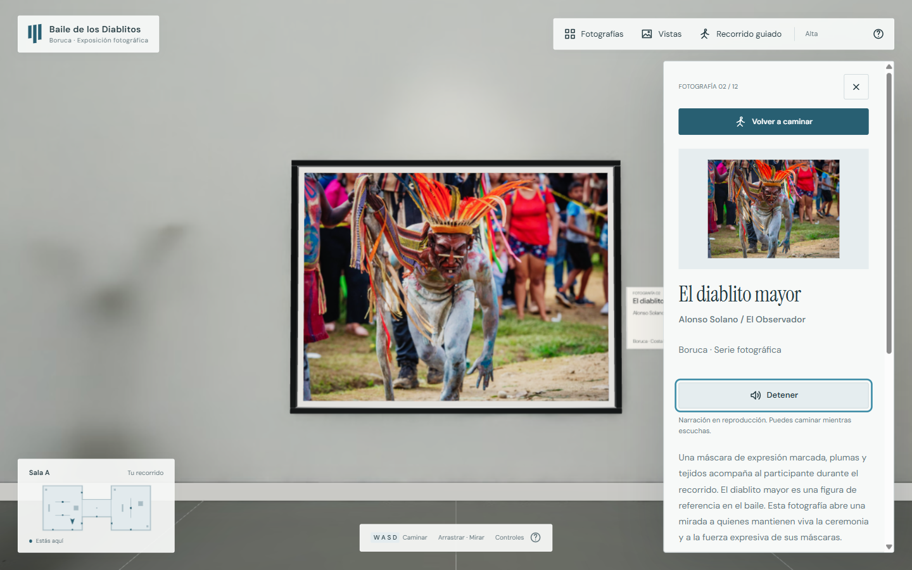
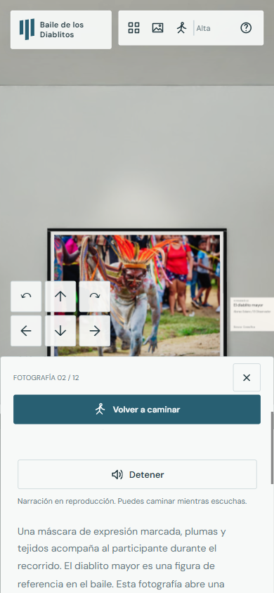

# Recorrido, inspección y narración

Implementación en el proyecto original, 14 de octubre de 2026. Se conservan las doce fotografías, la máscara, la arquitectura, los materiales, los textos descriptivos originales y la estructura visual. Los textos de guía se añaden como contexto, detalle para observar y enlace a la próxima parada; no se presentan como transcripciones del MP3.

## Uso

El visitante puede caminar libremente o pulsar **Recorrido guiado**. El orden sigue el catálogo de las doce fotografías a través de Sala A, pasillo y Sala B. Usa los puntos despejados y los acercamientos existentes: movimiento suave cuando el trayecto es libre y transición breve cuando una pared impediría cruzar directamente. El tiempo de contemplación empieza al llegar. Sin narración, permanece 12 segundos en cada parada. **Pausar** detiene el acercamiento y el reloj; **Continuar** requiere una acción explícita. Anterior y Siguiente permiten cambiar de parada y mantienen la posición del recorrido sincronizada.

Seleccionar una fotografía abre su ficha y encuadra la obra. La salida **Volver a caminar** permanece visible arriba, incluso al desplazar la ficha. Escape realiza la misma salida. Se invalidan los acercamientos pendientes y el recorrido automático, sin esperar una animación de regreso. Si se inspeccionó sin caminar, se recupera inmediatamente la vista previa; si el visitante caminó con la ficha abierta, conserva su posición elegida.

## Grabación

Solo **El diablito mayor**, fotografía 02, ofrece **Escuchar narración**. Utiliza el archivo proporcionado, copiado sin conversión a `public/audio/diablo-mayor-es.mp3`, de 679 820 bytes y 41,36 segundos según el navegador. SHA-256 idéntico al original:

`2655a05751025f6b63969f2ba2abd986e75ccc4328ccd2cc2cd750b62f01d1e8`

El audio se descarga y reproduce únicamente tras pulsar el botón. No hay síntesis de voz ni grabaciones de sustitución. El botón cambia a **Detener** durante la carga y la reproducción. El recorrido espera tanto la carga como la reproducción; al terminar naturalmente, deja dos segundos antes de avanzar. Si falla la reproducción, devuelve el botón a Escuchar, comunica el fallo y pausa el recorrido.

Caminar o arrastrar recupera el control manual y pausa el recorrido, conservando la ficha y la narración. El audio continúa mientras una parte de la fotografía esté en el campo de visión, no esté oculta por un objeto opaco y se encuentre a ocho metros o menos. La comprobación se omite durante el acercamiento inicial. Al perder esa condición, se detiene y no se reinicia por volver a mirar. Hace falta otro clic en Escuchar.

Cerrar, Escape, Detener, cambiar de obra o cambiar el idioma del documento detienen la grabación anterior. El proyecto original está en español; no se añadió un selector que prometiera traducciones inexistentes. Si el idioma del documento cambia, el MP3 en español queda deshabilitado para otro idioma y nunca se sustituye por una voz generada. Pérdida de foco, pestaña oculta, salida de la página y pérdida del contexto WebGL detienen el audio y cancelan el movimiento. Regresar o redimensionar después de una pausa no reinicia el recorrido.

Los diálogos modales de catálogo, vistas, imagen ampliada y ayuda pausan el recorrido y cancelan el desplazamiento antes de bloquear controles. Cerrarlos no reanuda automáticamente. La ficha de inspección durante la visita permanece no modal: teclado, arrastre y botones táctiles siguen disponibles.

## Evidencia

**Ran:** 59 pruebas unitarias, TypeScript y compilación de producción. Las regresiones cubren reloj desde la llegada, pausa y continuación explícitas, espera y final del audio, cancelaciones y eventos tardíos, rechazo de reproducción, rutas locales, campo de visión, rango y paredes que ocultan las obras. Se mantiene el resto de pruebas de navegación, cámara, modelos, cartelas, reflejos y planificación de fotogramas.

**Ran:** Chromium local con MP3 real: reproducción durante el acercamiento, caminar cerca sin cortar ni cerrar, giro fuera de la obra, alejamiento, no reinicio al volver a mirar, Detener y Escape, cambio de idioma, pérdida de foco y no reinicio. Prueba del final natural del audio mediante búsqueda hacia sus últimos 150 ms: avance después de dos segundos. Comprobación de espera después de 13 segundos reproduciendo: seguía en la misma parada. Reproducción fallida mediante solicitud abortada: mensaje, botón y recorrido en pausa.

**Ran:** clics rápidos a tres obras y salida inmediata, sin ficha reabierta después de 1,5 segundos; pausa durante el acercamiento con posición estable después de 1,2 segundos; diálogo de ayuda y cierre sin reanudación.

**Ran:** producción en una pestaña nueva con `requestAnimationFrame` nativo, sin instrumentación del audio ni del código de la aplicación. Las doce fotografías conservan enfoque despejado y guía; solo la segunda tiene botón de narración. Cero solicitudes de MP3 antes de Escuchar, una después; caminar mantuvo Detener y Escape cerró la ficha. Sin errores de página.

**Ran:** emulación móvil de 390 × 844 y puntero táctil: botones de movimiento de 44 px, sin desbordamiento horizontal; caminar durante el MP3 mantuvo audio y ficha, soltar borró la entrada de movimiento y Escape detuvo todo. Es emulación, no una prueba en un teléfono físico.

**Skipped:** dispositivos físicos, Firefox y Safari, por no disponer de esos entornos en esta validación. No se ejecutó un benchmark de rendimiento nuevo ni una auditoría automatizada completa de accesibilidad. Se conserva la resolución de geometría, fotografías, sombras y reflejos; la carga de audio se difiere hasta la decisión del visitante.

**Manual:** revisión visual de las capturas y de los textos de guía. No se transcribió el MP3 ni se alteró su voz.

La vista de producción comprobada se sirvió en `http://127.0.0.1:5176/`. El puerto 5173 estaba ocupado por otra galería con título «Juego de los Diablitos», distinta del proyecto original; no se alteró ese servidor.
